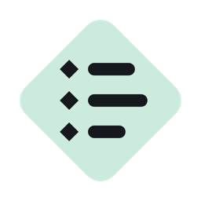
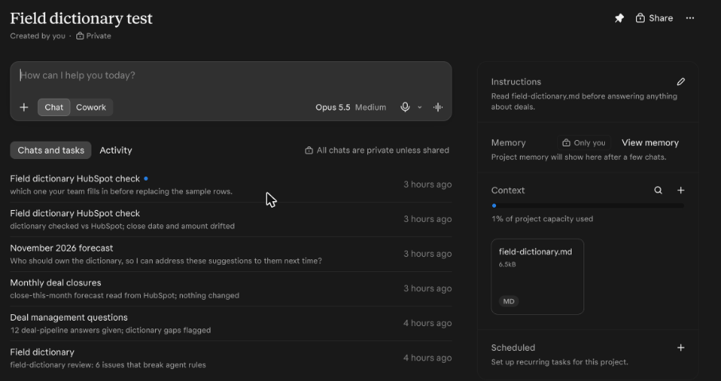
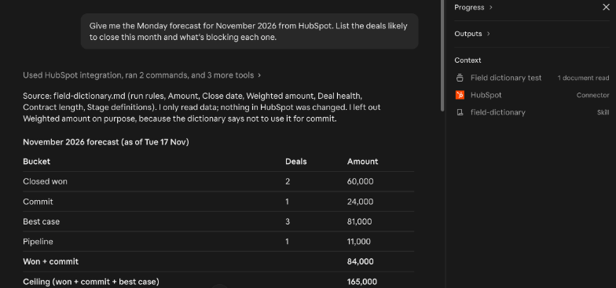

# Field dictionary kit

A field dictionary is one shared document that says what each field means in your team, for the AI agents that read your CRM, billing and project tools. This repository is a master copy for teams that use Claude Code or Codex. Every change goes through a pull request, so each one is reviewed and dated.

The sample rows describe Acme Corp, a made-up services firm. Acme Corp, Testco and every value in this repository are illustrative. Replace them with your own.

## What it looks like

Both screenshots show the Acme Corp sample with made-up Testco deals. They are illustrative.

A Claude Project holds field-dictionary.md and one line of instructions:



Asked for the Monday forecast, the agent names the entries it used, says it only read, and sorts deals by the stage definitions:



## What is in here

| Path | What it is |
|---|---|
| field-dictionary.md | The field dictionary. One file, at the root. Each field is defined here and nowhere else |
| jobs/ | One file per job an agent runs, listing the fields that job reads |
| checks/field-tests.md | Test questions with the answer the field dictionary gives |
| CHANGELOG.md | One dated line per change |
| CLAUDE.md | Claude Code reads this at the start of every session |
| AGENTS.md | Codex reads this at the start of every session. Same text as CLAUDE.md |
| .claude/skills/field-dictionary/ | The skill, where Claude Code looks for it |
| .agents/skills/field-dictionary/ | The same skill, where Codex looks for it |
| plugins/field-dictionary/ | The same skill packaged as a plugin, for people who install it without copying this repository |
| .claude-plugin/marketplace.json | The plugin listing Claude Code reads |
| .agents/plugins/marketplace.json | The plugin listing Codex and the ChatGPT desktop app read |
| checks/check-skill-copies.sh | A check that the three copies of the skill match |
| docs/images/ | The icon and the screenshots this page shows |
| .github/ | The pull request template and the CODEOWNERS file |

## Start

1. On GitHub, select Use this template to create your own repository. Branch protection rules don't come along, so set your own in step 6.
2. Open it in Claude Code or Codex and ask: Write our field dictionary. The skill interviews you about one job and drafts the entries.
3. Save the result as field-dictionary.md and the test questions as checks/field-tests.md. Replace the two sample files in jobs/ with one file per job of your own, and clear the sample line in CHANGELOG.md.
4. Put the owner's role and today's date at the top of field-dictionary.md.
5. In .github/CODEOWNERS, name the GitHub user or team that owns the field dictionary. That user or team needs write access to the repository. GitHub then asks them to review every pull request that changes field-dictionary.md. On a private repository this needs a paid GitHub plan.
6. To block a merge until the owner approves, add a branch protection rule on your main branch and select Require review from Code Owners. Without this rule, the owner's approval is a checkbox and nothing enforces it.

## Change a meaning

1. Edit field-dictionary.md on a branch. Update the Last reviewed date and the version at the top.
2. Add one line to CHANGELOG.md with today's date and who approved the change.
3. Update the matching question in checks/field-tests.md.
4. Open a pull request. The template asks for the owner's approval.
5. After the merge, update every copy outside this repository the same day, such as a Claude Project or a Salesforce field Description. Then ask a test question in each place.

Agents don't edit field-dictionary.md. They show a diff, and a person opens the pull request.

## Check it

Ask the agent: Check the field dictionary. The skill compares the file with the fields in your tools and lists anything added, renamed or removed. Run it once a quarter.

## Credentials

This repository holds no credentials and should never hold one. Connectors to your CRM, billing and project tools stay in each person's own app. The .gitignore blocks the usual secret files, and it is not a substitute for checking what you commit.

## Install only the skill, as a plugin

Use this when you want the skill in your own tools without copying this repository. The plugin holds instructions only: no scripts and no connections to other services.

In Claude Code, run this in a session:

```
/plugin install field-dictionary --marketplace pronovahq/field-dictionary-kit
```

In Codex, run these two lines in your shell:

```
codex plugin marketplace add pronovahq/field-dictionary-kit
codex plugin add field-dictionary@pronova-field-dictionary-kit
```

In the ChatGPT desktop app, open Plugins, select Add marketplace and enter pronovahq/field-dictionary-kit as the source.

The plugin doesn't hold your field dictionary. Keep field-dictionary.md where the skill looks for it: in the project's files, at the root of your repository, or attached to the chat.

## The three skill copies

The folders .claude/skills/field-dictionary/, .agents/skills/field-dictionary/ and plugins/field-dictionary/skills/field-dictionary/ hold the same files. If you change one, change the other two. To check that they match, run: sh checks/check-skill-copies.sh

## License

MIT. See LICENSE.
